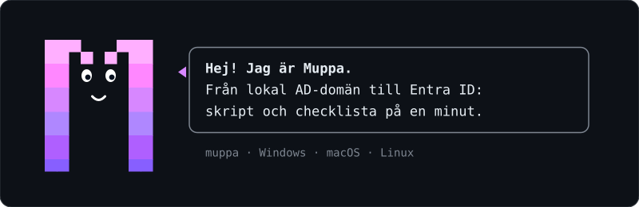

# Muppa

**English** · [Svenska](README.sv.md)

<p align="center">
  
</p>

Move a Windows computer from an **on-premises AD domain to Entra ID** without writing the script yourself.
You answer a few questions, and Muppa creates a **tailored PowerShell script** and a **checklist** for that particular
migration. Works the same on **Windows, macOS and Linux**, so the script can be prepared on your own computer.
One of the tools in the troupe with [Uppa](https://github.com/pipebreak33/uppa), [Puppa](https://github.com/pipebreak33/puppa),
[Euppa](https://github.com/pipebreak33/euppa), [Ruppa](https://github.com/pipebreak33/ruppa) and [Wuppa](https://github.com/pipebreak33/wuppa).
The mascot is an M with eyes. It blinks, looks around and is happy when the script is saved.

## Install (or update: run the same line again)

**Windows** (PowerShell):

```powershell
irm https://raw.githubusercontent.com/pipebreak33/muppa/main/install.ps1 | iex
```

**macOS / Linux:**

```bash
curl -fsSL https://raw.githubusercontent.com/pipebreak33/muppa/main/install.sh | sh
```

The installer finds (or on Windows installs) Python 3.8+, puts Muppa in `~/.muppa/app` and creates the command
`muppa` (`~/.local/bin/muppa`, or `%USERPROFILE%\.muppa\bin\muppa.cmd` + PATH on Windows). Your templates in
`~/.muppa` are never touched by an update. Choose the source with `MUPPA_REPO=owner/repo` and `MUPPA_BRANCH=branch`.
From a local copy: `./install.sh` / `./install.ps1`. `muppa --version` shows the version.

## Uninstall

**Windows** (PowerShell):

```powershell
irm https://raw.githubusercontent.com/pipebreak33/muppa/main/uninstall.ps1 | iex
```

**macOS / Linux:**

```bash
curl -fsSL https://raw.githubusercontent.com/pipebreak33/muppa/main/uninstall.sh | sh
```

Removes the program and the `muppa` command (and the PATH entry on Windows). Your templates in `~/.muppa` and created scripts in `~/Documents/Muppa` are kept.
`MUPPA_PURGE=1` removes your data too, and `MUPPA_YES=1` skips the question.

## How it works

1. **Questions.** The user (on Windows `C:\Users\*` is listed, otherwise you type the name), the target folder (default
   `C:\temp\<user>`), **which folders to copy** (checkboxes: Desktop, Documents, Pictures, Downloads,
   Music, Videos, Favorites, Contacts, Sticky Notes, Outlook signatures and your own paths), what should happen to files
   that only exist in the OneDrive cloud, browsers (Edge/Chrome), BitLocker (suspend, turn off, only save the key), a local
   admin account, domain/Entra ID and optional details (customer, responsible, computer, UPN, technician, ticket). If
   [Puppa](https://github.com/pipebreak33/puppa) is installed, the UPN can be picked straight from the tenant's users, with
   fuzzy search and the user name as a suggestion. Last you choose
   **which steps to include**. Every step can be left out.
2. **Preview.** Scroll through the script and the checklist, change the answers, and then save
   `Migrera-<user>.ps1` + `Checklista-<user>.md` in `~/Documents/Muppa/`.
3. **Templates.** Save the choices as a template, e.g. *Standard: Desktop+Documents+Pictures+Downloads · Edge · BitLocker suspended*.
   The next migration then starts from the template. Templates (`~/.muppa/mallar.json`) contain no passwords or secrets.

The wizard works like the rest of the troupe: arrow keys, digits as shortcuts, space to tick and fuzzy search when you start
typing. Ctrl+C cancels.

## Language

Muppa speaks **English** by default and **Swedish** on request: the wizard, the script's messages and the checklist.
The choice is shared by the whole troupe: `muppa lang sv` or `muppa lang en`, or the **Language** row in the menu. The script
gets a line `$Sprak = 'en'` at the top, which you can change afterwards. Swedish commands (`muppa ny`, `--mall` …) still work.

## Commands

| | |
|---|---|
| `muppa` | the menu |
| `muppa new [--template NAME]` | the wizard |
| `muppa create USER [--template NAME] [--folders skrivbord,dokument,…] [--path PATH] [--browsers edge,chrome] [--bitlocker pausa\|stang-av\|spara\|ingen] [--domain bada\|doman\|entra\|inget] [--admin NAME \| --no-admin] [--customer …] [--responsible …] [--computer …] [--upn …]` | script + checklist without questions |
| `muppa templates` | list templates |
| `muppa lang [en\|sv]` | language for the whole troupe |
| `--no-anim` | no animations (also off with `NO_COLOR` and when the output is piped) |

## The script

The script is for **Windows PowerShell 5.1** and runs on the computer being migrated. It runs in four phases:

```powershell
powershell.exe -ExecutionPolicy Bypass -File .\Migrera-anna.ps1 -Torrkorning   # try it: only shows what is done (= -WhatIf)
powershell.exe -ExecutionPolicy Bypass -File .\Migrera-anna.ps1                # as admin: prepare
powershell.exe -ExecutionPolicy Bypass -File C:\temp\anna\Migrera-anna.ps1 -Doman    # as local admin: leave the domain
powershell.exe -ExecutionPolicy Bypass -File C:\temp\anna\Migrera-anna.ps1 -Entra    # as local admin: join Entra ID
powershell.exe -ExecutionPolicy Bypass -File C:\temp\anna\Migrera-anna.ps1 -Aterlas  # as the user: restore
```

| Phase | What happens |
|---|---|
| prepare | Checks admin rights, logs everything (`Start-Transcript`) to the target folder and copies the script there. **Folders:** reads the real path from the user's `User Shell Folders` (loads `NTUSER.DAT` if the user is not signed in), so folders redirected to OneDrive are followed. Measures the size, counts files that **only exist in the cloud** (Files On-Demand) and checks free space. Then copies with `robocopy` and turns the exit codes into readable messages. **BitLocker:** `manage-bde -protectors -get` to a file and a backup to Entra ID/AD if the computer is joined. Then `Suspend-BitLocker` or `Disable-BitLocker`. **Browsers:** copies `Bookmarks` for every Edge/Chrome profile and turns them into an HTML file that can be imported. Passwords cannot be exported automatically, so the script opens `edge://settings/passwords` / `chrome://password-manager/settings` and waits while you save the CSV. **Taskbar:** copies the pinned shortcuts and the `Taskband` registry key and takes a screenshot. **Admin account:** the password is asked for with `Read-Host -AsSecureString` when the script runs. It is never in the script. |
| `-Doman` | Shows the local admin accounts, requires you to type **LEAVE** and runs `Remove-Computer`. Offers a restart. |
| `-Entra` | Opens `ms-settings:workplace` and describes the step *Join this device to Microsoft Entra ID*. Waits until `dsregcmd` shows `AzureAdJoined : YES`, backs up the BitLocker key to Entra ID and turns BitLocker back on. |
| `-Aterlas` | In the new profile: copies back with `robocopy /XO` (does not overwrite newer files) to the folders that `User Shell Folders` points to. Checks OneDrive (account, process, redirection), opens the import of bookmarks and passwords, shows the screenshot, starts Outlook and Teams and offers to delete the password files. |

At the top of the script are the settings (`$Sprak`, `$Cfg`, `$Steg`, `$Mappar`). You can turn off a step right there in the
file. A step that fails does not stop the rest: the script asks whether to continue.

## The checklist

The checklist covers the manual steps in the right order, with checkboxes: reset the password in Entra ID,
the OneDrive backup, save the BitLocker key outside the computer, sign in as local admin, Windows Hello (skip it at the
first sign-in), the Outlook profile, Teams, OneDrive sync, Teams/SharePoint libraries, pin icons as in the
screenshot, delete the password files and finally *tell the person responsible to set a new password*. Customer, responsible and computer
are optional fields.

## Security

- No passwords are saved: not in the script, the templates or the checklist.
- The password CSVs from the browsers contain plain text. Keep the target folder on the computer, not on a shared drive, and delete
  the files after the import. `-Aterlas` asks.
- The BitLocker key ends up in the target folder on the same disk. Save it outside the computer as well.

## Technology

One Python file (standard library only, 3.8+). Keys are read with `msvcrt` on Windows and `termios` on macOS/Linux.
The layout scales with the terminal: no lines wrap, a narrow layout below 58 columns, the mascot hides below 44, and everything
is redrawn when the window changes size. The generated script is saved as UTF-8 with a BOM, so that Windows PowerShell 5.1
reads å, ä and ö correctly.
